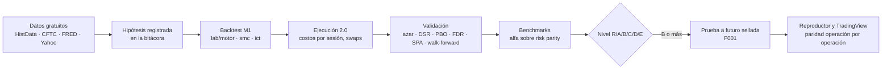

# trading-strategy-lab

Laboratorio para buscar una estrategia con **win rate ≥ 50 % y RR real ≥ 1:2**, con expectancy positiva y robustez. Si no aparece, el objetivo es documentar con números por qué.

- **Resumen para otras IAs:** `CONTEXTO_PARA_IAS.md`.
- **Historia completa:** `BITACORA.md`, con entradas fechadas, resultados y decisiones.
- **Reglas que no se cambian:** `docs/criterios.md`.
- **Plan y fundamento teórico:** `docs/plan.md`.
- **Costos por instrumento:** `docs/costos.md`.

## Cómo reproducir

```bash
pip install -r requirements.txt
python -m lab.descarga_histdata EURUSD GBPUSD USDJPY AUDUSD SPXUSD NSXUSD GRXEUR --desde 2016 --hasta 2026 --mes-actual 11
# historia 2010–2015 con --sufijo _2010 y luego lab.datos.unir_historia(<instr>) (ver data/README.md)
python -m pytest -q tests            # motor: casos a mano y teoría del paseo al azar
python experimentos/E001_linea_base.py XAUUSD,EURUSD
...
```

Cada experimento es un script en `experimentos/` que escribe sus resultados en `resultados/<EXXX>/`.

## Estructura

| Carpeta | Qué hay |
| --- | --- |
| `lab/` | Datos (`datos.py`, `externos.py` con fecha real de publicación), motor numba (`motor.py`), métricas (`metricas.py`, `ficha.py`), señales (`senales.py`, `grilla.py`, `smc.py`, `ict.py`), validación (`validacion.py`, `multiples.py`, `walkforward.py`, `objetivos.py`), ejecución y riesgo (`ejecucion.py`, `financiacion.py`, `montecarlo.py`, `cartera.py`, `benchmarks.py`), régimen (`regimen.py`), flujo y eventos (`flujo.py`, `eventos.py`), política y registro (`politica.py`, `registro.py`) |
| `experimentos/` | E000 calidad de datos · E001 línea de base · E002 filtros de tendencia · E003 tendencia operable · E004 retrocesos y reversión · E005 intradía · E006 retrocesos en índices · E007 régimen de volatilidad · E008 cartera de tendencia · E009 validación · E010 aprendizaje automático · E011 elección de candidatas · E012 Sharpe y teoría · E013 curva de la candidata · E014 divergencias y multi-temporalidad · E015 máximos de 52 semanas, estacionalidad y momentum transversal (E015b, E015c) · E016 COT · E017 retroceso en los líderes de momentum · E018 historia larga (pausada) · E019 búsqueda exhaustiva en los últimos 5 años · E020 pruebas de las finalistas · E021 sensibilidad · E022 estrategia recomendada · E023 setup SMC en 6 activos y 3 pares de temporalidades · E024 finalistas del setup SMC · E025 los 5 setups ICT del prompt de Google · E026–E027 auditoría y validación del oro D1 · E028 walk-forward y PBO · E029 alfa sobre benchmarks · E030 perfiles de ejecución · E031 pruebas múltiples y SPA · E032 riesgo y cartera · E033 COT e intermercado · E034 régimen HMM · E035 factores SMC y eventos con placebo · E036 tendencia multiactivo · E037 oro en GLD (pendiente) · E038 historia limpia de SMC/ICT · F001 prueba a futuro |
| `resultados/` | CSV y JSON de cada experimento |
| `pine/` | Estrategias en Pine Script v6 para el probador de TradingView: oro D1 Bollinger (`oro_d1_bollinger_sma200.pine`) el setup SMC configurable (`smc_barrido_estructura.pine`) y los 5 setups ICT (`ict_cinco_setups.pine`) |
| `tests/` | 27 pruebas (motor, fase 4 y fase 4b) |
| `registro/` | Presupuesto de pruebas, registro de experimentos con hash y prueba a futuro F001 |
| `herramientas/` | Exportador del tablero y comparador con TradingView |
| `data/` | No se sube; se regenera con la descarga |

## Universo

XAUUSD y XAGUSD; EURUSD, GBPUSD, USDJPY y AUDUSD; SPX500, NAS100, Nikkei 225, FTSE 100, CAC 40, ASX 200 y Hang Seng. Posicionamiento semanal de la CFTC (COT) para 9 mercados. El DAX y el WTI se bajaron pero se excluyeron por datos corruptos (E000). Son velas de 1 minuto de 2010 a 2026 (HistData, más Dukascopy para el oro reciente).

- Selección: 2010–2021.
- Validación: 2022–2026.

## Estado (27/11/2026, fase 4b)

**Lo que se sabe hoy:**
- **Oro D1 (E022) es la única candidata (nivel B).**
  - Le gana al azar (p = 0,0005).
  - Agrega alfa sobre una cartera pasiva (IR 0,85).
  - Resiste costos realistas (+0,33 R conservador).
  - Su familia de parámetros es positiva fuera de muestra.
  - Le falta un período limpio: la prueba a futuro F001 corre desde el 27/11/2026, sellada con hash.
- **Nada sobrevive a la corrección por pruebas múltiples** (E031): 297.354 configuraciones, y la SPA de Hansen da p = 0,21.
- **SMC e ICT en oro, en su historia nunca usada (2010–2021), son el azar** (E038): −0,03 R y +0,04 R. El barrido no predice la reversión (E035b).
- **Lo que sí suma dentro del setup SMC** (E035a): barrer la liquidez del día anterior y operar en killzones. Lo que resta: entrar en FVG u OB.

**Dónde mirar:**
- `docs/plan_evolucion.md` (plan y respuesta a los prompts);
- `docs/auditoria_fase0.md` (auditoría A–K);
- `docs/fichas.md` (cada estrategia);
- `docs/datos_gratuitos.md`;
- `BITACORA.md`, entradas 25 a 31.
- **Tablero:** artifact "Tablero del laboratorio". **Reproductor** con red de decisión: link público en `CONTEXTO_PARA_IAS.md`.



**Estrategia recomendada para los últimos 5 años:** oro D1, ruptura de Bollinger (20, 2) a favor de la SMA 200, SL 0,5 ATR(14), TP 2 × SL. Da 55,2 % de acierto y +0,63 R por operación en 2021–2026 (58 operaciones), y 43,6 % y +0,29 R en 2011–2021. Código: `pine/oro_d1_bollinger_sma200.pine`. Operaciones para comparar con el probador: `resultados/E022/operaciones_5a.csv`. Detalle en `BITACORA.md`, entradas 18 y 19.

**Setup SMC de Fabrizio (scalping y daytrading):** se probaron 171.072 variantes en 6 activos y en 1H–5M, 4H–15M y 15M–1M, en los últimos 5 años. Ninguna llega a 50 % de acierto con RR 1:2; el promedio es 33 %, igual que el azar. Las mejores de cada activo dan 43–47 %, pero elegir así no funcionó a futuro. Estrategia configurable: `pine/smc_barrido_estructura.pine`. Detalle en `BITACORA.md`, entradas 20 y 21.

**Los 5 setups ICT del prompt de Google:** pierden en los 6 activos con la configuración del prompt (19.908 pruebas, RR 1:2, últimos 5 años). Ninguna variante llega a 50 % de forma estable. Script: `pine/ict_cinco_setups.pine`. Detalle en `BITACORA.md`, entradas 22 y 23.


**Fases 1 y 2 terminadas.** Resumen en `docs/conclusiones.md`:
- **Cumple los criterios mínimos:** una estrategia de tendencia de largo plazo, solo compras, SL de 6 ATR y TP 2,1× en índices, oro y plata. Da 51,0 % en selección y 55,6 % en validación, con payoff 2,06–2,08.
- **No es robusta como ventaja:** rinde lo mismo que comprar siempre con el mismo SL/TP.
- **Con señales técnicas** de corto y mediano plazo no apareció 50 % con 1:2 en unas 1.560 configuraciones. La teoría del movimiento browniano con deriva explica por qué.
- **Fase 2:** el momentum de corte transversal (comprar los activos más fuertes y sus retrocesos) es la única señal que le gana a comprar siempre (+2 a +9 puntos de acierto). Llega a 50,0–52,5 % con unas 100 operaciones, pero los parámetros vecinos caen a 44–47 %: no pasa la regla de robustez.
- **Fase 3 (pausada):** prueba en la historia diaria de 1990–2009. El código y el control de calidad de los datos quedaron listos (E018).
